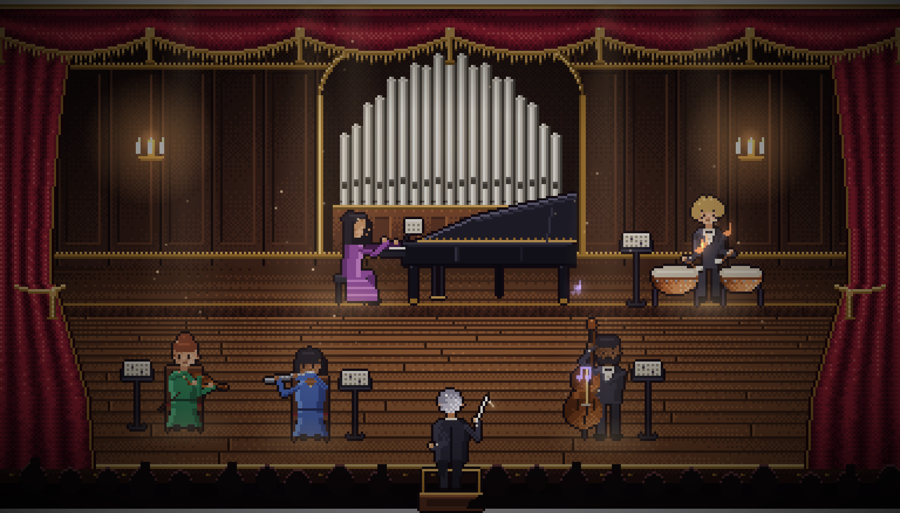
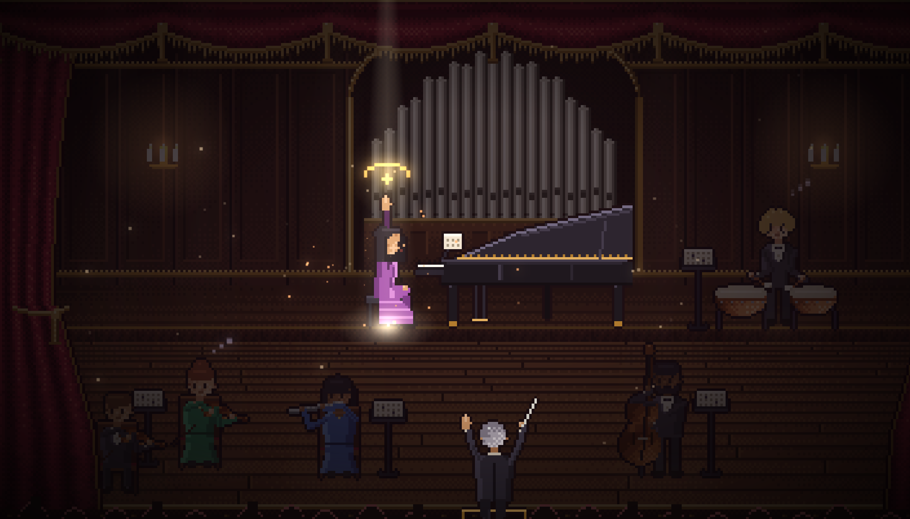

<div align="center">

# 𝄐 Bytehoven

### Your AI coding agents, as a living orchestra.

Every agent is a musician on a pixel-art concert stage.<br/>
Every tool call becomes music. **Hear** what your agents are doing without looking.<br/>
And when one of them needs you, the whole hall holds its breath.



[Run it](#-run-it) · [What you hear](#-what-you-hear) · [The fermata](#-the-fermata) · [How it's built](#-how-its-built) · [Roadmap](#-roadmap)

**English** · Türkçe arayüz dahil

</div>

---

> **Status: demo mode.** Five simulated agents perform a scripted concert so you can see and hear every feature in about a minute. Live Claude Code sessions are next on the roadmap.

## ✨ Why

Agent dashboards make you *watch*. Sound notification tools make you *flinch* at a "ding". Bytehoven does neither: it turns your agents' work into **one continuous, in-tune piece of music** with a stage to match.

- **Real instruments.** Piano, violin, flute, double bass and timpani, sampled from the CC0 VSCO 2 orchestral library, played through a concert-hall reverb.
- **Always in tune, always in time.** Everything plays in D major at 92 BPM, quantised to the beat. An agent can't play a "wrong" note, except when something actually breaks.
- **Sound and picture in perfect sync.** Every animation is scheduled on the audio clock, at the exact moment its note sounds.
- **Spatial.** Where a musician sits on stage is where you hear them in stereo.
- **Zero tokens.** Bytehoven never calls a model. It only listens.

## 🎻 What you hear

| When an agent… | the musician… | and you hear… |
| --- | --- | --- |
| calls a tool | plays | a short motif in the current chord |
| reads a file | turns a page on the music stand | a soft single note |
| writes a file | plays with weight | a chord |
| runs a shell command | plays rhythmically | a repeated pulse |
| is thinking | tunes up | a quiet tuning A |
| goes idle | dozes off · *zzz* | silence |
| fails a test | winces, red sparks fly | a dissonant cluster |
| passes the tests | beams | a V → I cadence with timpani and cymbal |
| spawns a sub-agent | a second chair walks on stage | a harp sweep, then a new voice joins |
| finishes a task | takes a small bow | a short finale |
| **needs your permission** | **raises a hand** | **a fermata (below)** |

**Bursts don't become noise.** When 20 file reads land in three seconds, you don't get 20 dings. The backlog turns into one flowing scale run.

| Default role → instrument | |
| --- | --- |
| Code → 🎹 Piano | Research → 🎻 Violin |
| Tests → 🥁 Timpani | Docs → 🪈 Flute |
| Refactor → Double bass | Sub-agents → second chairs |

## 𝄐 The fermata



A *fermata* is the sign that tells an orchestra to **hold**. When an agent waits for your permission, Bytehoven holds:

1. The music stops moving and sustains a dominant **A7** chord.
2. Tremolo strings enter layer by layer. The filter opens. A heartbeat starts in the bass drum and speeds up.
3. The hall darkens, the camera leans in, and the spotlight narrows on the musician with the raised hand.
4. The conductor (you) holds a hand up too.

Press **Approve** (or Enter) and the chord **resolves** to D major in full orchestra: harp, cymbal, a shower of golden light. Press **Deny** (Esc) and it slips into a deceptive cadence, which sounds exactly like "not yet".

Tension builds gradually instead of beeping at you. That's the point: you'll feel that someone is waiting before you consciously notice.

## 🚀 Run it

Requires Node 20+.

```bash
git clone https://github.com/berkinozturk/bytehoven.git
cd bytehoven
npm install
npm run dev
```

Open **http://127.0.0.1:5180** and press **Begin the concert** (browsers only allow sound after a click). The server only listens on `127.0.0.1`.

On your first visit, a short **guided tour** introduces the orchestra. Each musician steps into the spotlight and plays a phrase in their own voice, then the tour shows you the conductor, the live score, the fermata and the programme. Use Enter / → to continue, ← to go back and Esc to skip. You can replay it any time with the **?** button in the top bar.

**Things to try**

- Click a musician to see their session, recent tool calls and volume, and to hand them a new part. The conductor points the baton at them.
- Switch **EN / TR** in the top bar.
- Trigger moments by hand from the browser console:

```js
bytehoven.sim.requestPermission('clara')  // a fermata
bytehoven.sim.fire('otto', 'test_fail')   // a sour chord
bytehoven.sim.fire('mira', 'task_done')   // a little finale
```

### Next to Claude Code

Bytehoven fits a narrow side panel: below 720px wide it switches to a compact layout (stage on top, score and programme underneath, the permission card docked at the bottom of the stage, the musician drawer as an overlay).

| Where you run Claude Code | How to keep Bytehoven beside it |
| --- | --- |
| **Claude desktop app** | Ask Claude to open `http://127.0.0.1:5180` in its browser pane, next to the chat. |
| **VS Code / Cursor** | Command palette → **Simple Browser: Show** → `http://127.0.0.1:5180`, then drag the tab next to the Claude Code panel. |
| **Terminal** | In Chrome or Edge, press the **pop-out** button in the top bar. Bytehoven moves into a small always-on-top window that floats over your terminal. Close it (or press *Bring it back*) to return. |

The pop-out uses the browser's [Document Picture-in-Picture](https://developer.chrome.com/docs/web-platform/document-picture-in-picture) API (Chrome / Edge 116+). The button is hidden in browsers that can't open one. Sound keeps playing from the original tab.

## 🛠 How it's built

| | |
| --- | --- |
| **Vite + TypeScript** | strict, zero runtime framework |
| **PixiJS 8** | the stage. A rendering engine, not a game framework, so it doesn't bring a second audio system to fight with. Its filters give us bloom; the HTML UI sits cleanly on top. |
| **Tone.js** | one Transport clock, sample-based instruments, convolution reverb, a channel per musician |
| **Pixel art** | drawn procedurally in code (`src/stage/`), pixel by pixel: hall, organ, curtains, musicians, instruments, conductor. No sprite packs, so it's all MIT and easy to re-theme. |

```
src/
  core/      event model (the contract for live data) and the demo simulator
  audio/     engine: scheduler, harmony, cadences, the fermata
  stage/     pixel toolkit, hall, musicians, lights, particles, camera
  ui/        live score strip, programme feed, tension meter, detail drawer
  i18n/      en · tr
scripts/
  prepare-samples.mjs   raw VSCO WAVs → trimmed, pitch-verified MP3s
```

The event model carries **only** a tool name, a short target (such as a file name) and a status. Prompts, messages and file contents are never part of it, by design.

<details>
<summary><b>Rebuilding the samples</b></summary>

The processed MP3s (about 7 MB) are committed, so you don't need this to run Bytehoven.

To rebuild them, download the instrument folders listed in [CREDITS.md](CREDITS.md) from [VSCO-2-CE](https://github.com/sgossner/VSCO-2-CE) into `samples-raw/<group>/`, then run:

```bash
npm run prepare-samples -- samples-raw
```

The script trims the silence before each attack, caps the length with a fade, peak-normalises the sample and encodes it as mono MP3. It also runs a YIN pitch detector to catch octave-mislabelled samples, because some instruments in the library are named an octave off.

</details>

## 🔒 Privacy

- **No model calls, ever.** Bytehoven costs 0 tokens.
- **Local only.** The dev server binds to `127.0.0.1`.
- **Metadata only.** When live mode lands, Bytehoven will read Claude Code's local transcripts **read-only**, and only tool names, short targets and status. Prompts, messages and file contents are never read or stored.

## 🗺 Roadmap

- [x] **Demo mode**: Orchestra theme, five musicians, fermata, sub-agents, errors, live score
- [x] **First-run tour**: each musician steps into the spotlight and plays, then the conductor, live score, fermata and programme are introduced
- [x] **Next to Claude Code**: a compact layout for side panels, plus an always-on-top pop-out window
- [ ] **Live mode**: read `~/.claude/projects/**/*.jsonl` (read-only), with optional Claude Code hooks for instant permission events
  - find live sessions via `~/.claude/sessions/<pid>.json`; desktop-app sessions don't register there, so also pick up recent transcripts whose `entrypoint` is `claude-desktop`
  - real second chairs from `<session>/subagents/agent-*.meta.json` (type and last tool only, never message text)
  - map sessions to musicians by working folder or tmux window name, and log a ready-to-paste mapping line for any session that matches none
  - local server checks the `Host` and `Origin` headers, so other websites can't talk to it (DNS-rebinding protection)
  - on page load, replay the last few events before going live, so the score never starts empty
- [ ] **Box office**: today's tokens per musician, de-duplicated by message id, with cache reads shown separately (they're re-read context, not new work)
- [ ] **Conducting**: hand a musician a new part (`claude -p`, prompt via stdin, narrow tool permissions, `rm` / `git push` / `curl` blocked by default)
  - the conductor plans first: one tool-less `claude -p --json-schema` call returns who plays what; the plan is validated, and nothing starts if it's malformed. A dry-run shows the plan without running it
- [ ] **Themes**, each with its own stage and sound: Jazz club 🎷, Chiptune arcade 👾, Lo-fi rainy room 🌧
- [ ] **Mixer**: which event plays which sound, instrument assignment per role
- [ ] **"Today's symphony"**: export a session as a short video/GIF with sound, ready to share
- [ ] Codex and Gemini CLI support

## 🤝 Contributing

Issues and ideas are very welcome, especially new themes, instruments and musician poses. Please keep any assets you add CC0 or equivalent, and list them in [CREDITS.md](CREDITS.md).

```bash
npm run typecheck   # strict TypeScript
npm run build       # production build in dist/
```

## 🙏 Credits

Instrument samples: **VS Chamber Orchestra: Community Edition** by [Versilian Studios](https://vis.versilstudios.net/vsco-community.html), CC0. Fonts: Cormorant Garamond and Inter (SIL OFL 1.1). Everything else in the repo, including all the pixel art, is original. Full list in [CREDITS.md](CREDITS.md).

## License

[MIT](LICENSE)
