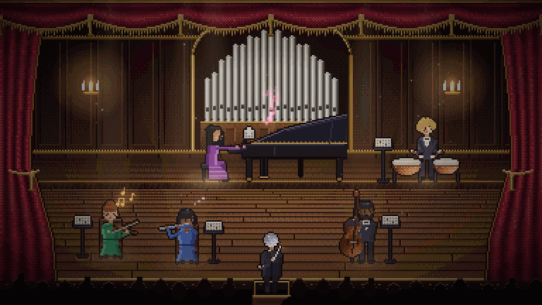

<div align="center">

# 𝄐 Bytehoven

### Your AI coding agents, as a living orchestra.

Every agent is a musician on a pixel-art concert stage.<br/>
Every tool call becomes music. **Hear** what your agents are doing without looking.<br/>
And when one of them needs you, the whole hall holds its breath.



[Run it](#-run-it) · [What you hear](#-what-you-hear) · [The fermata](#-the-fermata) · [How it's built](#-how-its-built) · [Roadmap](#-roadmap)

**English** · Türkçe arayüz dahil

</div>

---

> **Status: early.** Watch the **demo** (five simulated agents, every feature in about a minute) or switch to **Live** and hear your own running Claude Code sessions.

## ✨ Why

Agent dashboards make you *watch*. Sound notification tools make you *flinch* at a "ding". Bytehoven does neither: it turns your agents' work into **one continuous, in-tune piece of music** with a stage to match.

- **Real instruments.** Piano, violin, flute, double bass and timpani, sampled from the CC0 VSCO 2 orchestral library, played through a concert-hall reverb.
- **Always in tune, always in time.** Everything plays in D major at 92 BPM, quantised to the beat. An agent can't play a "wrong" note, except when something actually breaks.
- **Sound and picture in perfect sync.** Every animation is scheduled on the audio clock, at the exact moment its note sounds.
- **Spatial.** Where a musician sits on stage is where you hear them in stereo.
- **Zero tokens.** Bytehoven never calls a model. It only listens.

## 🎻 What you hear


| When an agent… | the musician… | and you hear… |
| --- | --- | --- |
| calls a tool | plays | a short motif in the current chord |
| reads a file | turns a page on the music stand | a soft single note |
| writes a file | plays with weight | a chord |
| runs a shell command | plays rhythmically | a repeated pulse |
| is thinking | tunes up | a quiet tuning A |
| goes idle | dozes off · *zzz* | silence |
| fails a test | winces, red sparks fly | a dissonant cluster |
| passes the tests | beams | a V → I cadence with timpani and cymbal |
| spawns a sub-agent | a second chair walks on stage | a harp sweep, then a new voice joins |
| finishes a task | takes a small bow | a short finale |
| **needs your permission** | **raises a hand** | **a fermata (below)** |

**Bursts don't become noise.** When 20 file reads land in three seconds, you don't get 20 dings. The backlog turns into one flowing scale run.

| Default role → instrument | |
| --- | --- |
| Code → 🎹 Piano | Research → 🎻 Violin |
| Tests → 🥁 Timpani | Docs → 🪈 Flute |
| Commands & builds → Double bass | Sub-agents → second chairs |

## 🎷 Themes

Pick a theme from the chip in the top bar. Each one is its own band on its own stage, and the five chairs keep their roles.

| | Orchestra | Jazz club | Lo-fi room |
| --- | --- | --- | --- |
| Stage | concert hall, organ, velvet curtains | brick wall, neon sign, string lights, candle-lit tables | a flat at night: rainy window over the city, bookshelf, a cat on the sill, friends on cushions |
| Key and tempo | D major, 92 BPM | F major, 116 BPM, swing | C major, 76 BPM, lazy swing |
| While agents work | a soft string pad | walking bass, ride cymbal, piano comping | boom-bap drums, bass guitar, rolled ninth chords, all through worn tape and vinyl crackle |
| Code · research · docs · tests · commands | piano · violin · flute · timpani · double bass | piano · tenor sax · muted trumpet · drums · double bass | upright piano · jazz guitar · vibraphone · drums · bass guitar |
| The fermata | A7 in tremolo strings → D | C7♭9 on sax, trumpet and piano, the ride swelling → Fmaj7 | G7♭9 on vibes, guitar and piano, the hi-hat ticking faster → Cmaj9 |

Chiptune is next. `?theme=jazz` or `?theme=lofi` in the URL opens a theme directly.

## 𝄐 The fermata


A *fermata* is the sign that tells an orchestra to **hold**. When an agent waits for your permission, Bytehoven holds:

1. The music stops moving and sustains a dominant **A7** chord.
2. Tremolo strings enter layer by layer. The filter opens. A heartbeat starts in the bass drum and speeds up.
3. The hall darkens, the camera leans in, and the spotlight narrows on the musician with the raised hand.
4. The conductor (you) holds a hand up too.

Press **Approve** (or Enter) and the chord **resolves** to D major in full orchestra: harp, cymbal, a shower of golden light. Press **Deny** (Esc) and it slips into a deceptive cadence, which sounds exactly like "not yet".

Tension builds gradually instead of beeping at you. That's the point: you'll feel that someone is waiting before you consciously notice.

## 🚀 Run it

Requires Node 20+.

```bash
git clone https://github.com/berkinozturk/bytehoven.git
cd bytehoven
npm install
npm run dev
```

Open **http://127.0.0.1:5180** and press **Begin the concert** (browsers only allow sound after a click). The server only listens on `127.0.0.1`.

On your first visit, a short **guided tour** introduces the orchestra. Each musician steps into the spotlight and plays a phrase in their own voice. A **signal lesson** lets you play every sound on its own (reading, writing, a command, thinking, a failure, passing tests, a sub-agent joining, a finished part, the fermata) and tells you what it means, so you can follow your agents by ear. Then the tour shows you the conductor, the live score, the fermata and the programme. Use Enter / → to continue, ← to go back and Esc to skip. You can replay it any time with the **?** button in the top bar.

**Things to try**

- Click a musician to see their session, recent tool calls and volume, and to hand them a new part. The conductor points the baton at them.
- Switch **EN / TR** in the top bar.
- Trigger moments by hand from the browser console:

```js
bytehoven.sim.requestPermission('clara')  // a fermata
bytehoven.sim.fire('otto', 'test_fail')   // a sour chord
bytehoven.sim.fire('mira', 'task_done')   // a little finale
```

### Live mode: your own Claude Code sessions

Press **Live** in the top bar (or open `http://127.0.0.1:5180/?live`). The whole band is on stage, and every musician stands for a kind of work, whichever session does it:

| Work | Musician |
| --- | --- |
| editing code | Clara · piano |
| editing docs (`.md` and friends) | Mira · flute |
| reading, searching, the web | Ines · violin |
| running tests | Otto · timpani |
| other commands and builds | Bruno · double bass |

All your running sessions play the same orchestra; every line in the programme shows which project folder it came from. Sub-agents join as second chairs, and musicians with nothing to do doze off.

**The fermata, with a real Approve button.** To hear the hall hold its breath when a session needs your permission, add Bytehoven's hook to Claude Code:

```bash
npm run hooks              # shows what would be added, changes nothing
npm run hooks -- --write   # adds it to ~/.claude/settings.json (backs the file up first)
npm run hooks -- --remove  # takes it out again
```

Then start a new Claude Code session. When it asks for permission, the musician for that kind of work raises a hand (the card shows which project is asking), and **Approve** / **Deny** in Bytehoven answer Claude Code directly. Each answer covers that one request only; there is no "always allow". If Bytehoven isn't open, or you don't answer within about 50 seconds, Claude Code asks you as usual.

The hook is documented for the terminal and VS Code. Whether the Claude desktop app runs user hooks isn't documented, so try it there before relying on it.

### Conducting: hand a musician a new part

In live mode, click a musician and write a task in **New part**. Bytehoven starts a one-off `claude -p` in the project folder that musician last played for, and the musician's second chair walks on stage to play it; when it needs permission, you get the fermata.

- `claude` is started with an argument list and the task goes to its **stdin**, so nothing you type is ever parsed as a shell command.
- Reading, searching and editing files are allowed. Other tools follow your Claude Code permission settings, and anything that asks for permission comes to you as a fermata.
- `rm`, `git push` and `curl` are always blocked.
- One part at a time. The task text and the model's answer are never logged or stored.

### Next to Claude Code

Bytehoven fits a narrow side panel: below 720px wide it switches to a compact layout (stage on top, score and programme underneath, the permission card docked at the bottom of the stage, the musician drawer as an overlay).

| Where you run Claude Code | How to keep Bytehoven beside it |
| --- | --- |
| **Claude desktop app** | Ask Claude to open `http://127.0.0.1:5180` in its browser pane, next to the chat. |
| **VS Code / Cursor** | Command palette → **Simple Browser: Show** → `http://127.0.0.1:5180`, then drag the tab next to the Claude Code panel. |
| **Terminal** | In Chrome or Edge, press the **pop-out** button in the top bar. Bytehoven moves into a small always-on-top window that floats over your terminal. Close it (or press *Bring it back*) to return. |

The pop-out uses the browser's [Document Picture-in-Picture](https://developer.chrome.com/docs/web-platform/document-picture-in-picture) API (Chrome / Edge 116+). The button is hidden in browsers that can't open one. Sound keeps playing from the original tab.

## 🛠 How it's built

| | |
| --- | --- |
| **Vite + TypeScript** | strict, zero runtime framework |
| **PixiJS 8** | the stage. A rendering engine, not a game framework, so it doesn't bring a second audio system to fight with. Its filters give us bloom; the HTML UI sits cleanly on top. |
| **Tone.js** | one Transport clock, sample-based instruments, convolution reverb, a channel per musician |
| **Pixel art** | drawn procedurally in code (`src/stage/`), pixel by pixel: hall, organ, curtains, musicians, instruments, conductor. No sprite packs, so it's all MIT and easy to re-theme. |

```
src/
  core/      event model, the demo simulator and the live source
  audio/     engine: scheduler, harmony, the fermata; themes/ hold each band's sound
  stage/     pixel toolkit, hall, jazz club, lo-fi room, musicians, lights, particles, camera
  ui/        live score strip, programme feed, tension meter, detail drawer
  i18n/      en · tr
server/live/  read-only session reader, transcript parser, local endpoints
bin/          the Claude Code permission hook and its installer
tests/        node --test suites (parser privacy, reader, endpoints)
scripts/
  prepare-samples.mjs   raw VSCO WAVs → trimmed, pitch-verified MP3s
```

The event model carries **only** a tool name, a short target (such as a file name) and a status. Prompts, messages and file contents are never part of it, by design.

<details>
<summary><b>Rebuilding the samples</b></summary>

The processed MP3s (about 10 MB) are committed, so you don't need this to run Bytehoven.

To rebuild them, download the instrument folders listed in [CREDITS.md](CREDITS.md) from [VSCO-2-CE](https://github.com/sgossner/VSCO-2-CE) into `samples-raw/<group>/`, then run:

```bash
npm run prepare-samples -- samples-raw
```

The script trims the silence before each attack, caps the length with a fade, peak-normalises the sample and encodes it as mono MP3. It also runs a YIN pitch detector to catch octave-mislabelled samples, because some instruments in the library are named an octave off.

</details>

## 🔒 Privacy

- **No model calls, ever.** Bytehoven costs 0 tokens.
- **Local only.** The dev server binds to `127.0.0.1`.
- **Metadata only.** Live mode reads Claude Code's local session list and transcripts **read-only** (`~/.claude/sessions`, `~/.claude/projects`). Each line is parsed in memory and only the tool name, a file's base name, a command's first word (`git`, `npm test`) and whether it failed are kept. Prompts, messages, thinking, file contents, full paths and full commands are dropped on the spot, never stored and never sent anywhere. A test (`tests/parse.test.ts`) checks that none of them can leak.
- **The permission hook** sends only the session id, the tool name and the same short target to `127.0.0.1`. The local endpoints check the `Host` header (no DNS rebinding), only accept Approve / Deny from Bytehoven's own page, and only accept the hook's call with a random token stored in `.bytehoven/live.json`, readable only by you.
- **Format caveat.** Claude Code's transcript format is internal and can change between versions; if a release changes it, live mode may go quiet until Bytehoven catches up.

## 🗺 Roadmap

- [x] **Demo mode**: Orchestra theme, five musicians, fermata, sub-agents, errors, live score
- [x] **First-run tour**: each musician steps into the spotlight and plays, then the conductor, live score, fermata and programme are introduced
  - [x] **A sound lesson**: let the tour play each signal on its own (a file read, a write, a shell command, a failing and a passing test, a sub-agent joining, a finished turn, the fermata) and say what it means, so you can follow your agents by ear
- [x] **Next to Claude Code**: a compact layout for side panels, plus an always-on-top pop-out window
- [x] **Live mode**: running sessions and sub-agents read live, read-only; a permission hook for the fermata with real Approve / Deny
  - [ ] choose which session sits in which chair (by folder), instead of first come, first seated
  - [ ] on page load, replay the last few events so the score never starts empty
- [ ] **Box office**: today's tokens per musician, de-duplicated by message id, with cache reads shown separately (they're re-read context, not new work)
- [x] **Conducting**: hand a musician a new part (`claude -p`, prompt via stdin, narrow tool permissions, `rm` / `git push` / `curl` blocked)
  - [ ] next: the conductor plans first: one tool-less `claude -p --json-schema` call returns who plays what; the plan is validated, and nothing starts if it's malformed. A dry-run shows the plan without running it
- [x] **Themes**: a theme picker; each theme is its own band (sound) on its own stage (pixel art)
  - [x] Jazz club 🎷
  - [ ] Chiptune arcade 👾 (synthesised, no samples)
  - [x] Lo-fi rainy room 🌧
- [ ] **Mixer**: which event plays which sound, instrument assignment per role
- [ ] **"Today's symphony"**: export a session as a short video/GIF with sound, ready to share
- [ ] Codex and Gemini CLI support

## 🤝 Contributing

Issues and ideas are very welcome, especially new themes, instruments and musician poses. Please keep any assets you add CC0 or equivalent, and list them in [CREDITS.md](CREDITS.md).

```bash
npm run typecheck   # strict TypeScript
npm test            # node --test, no extra dependencies
npm run build       # production build in dist/
```

## 🙏 Credits

Instrument samples: **VS Chamber Orchestra: Community Edition**, **VCSL** and **Virtuosity Drums** by [Versilian Studios](https://vis.versilstudios.net/vsco-community.html), all CC0. Fonts: Cormorant Garamond and Inter (SIL OFL 1.1). Everything else in the repo, including all the pixel art, is original. Full list in [CREDITS.md](CREDITS.md).

## License

[MIT](LICENSE)
